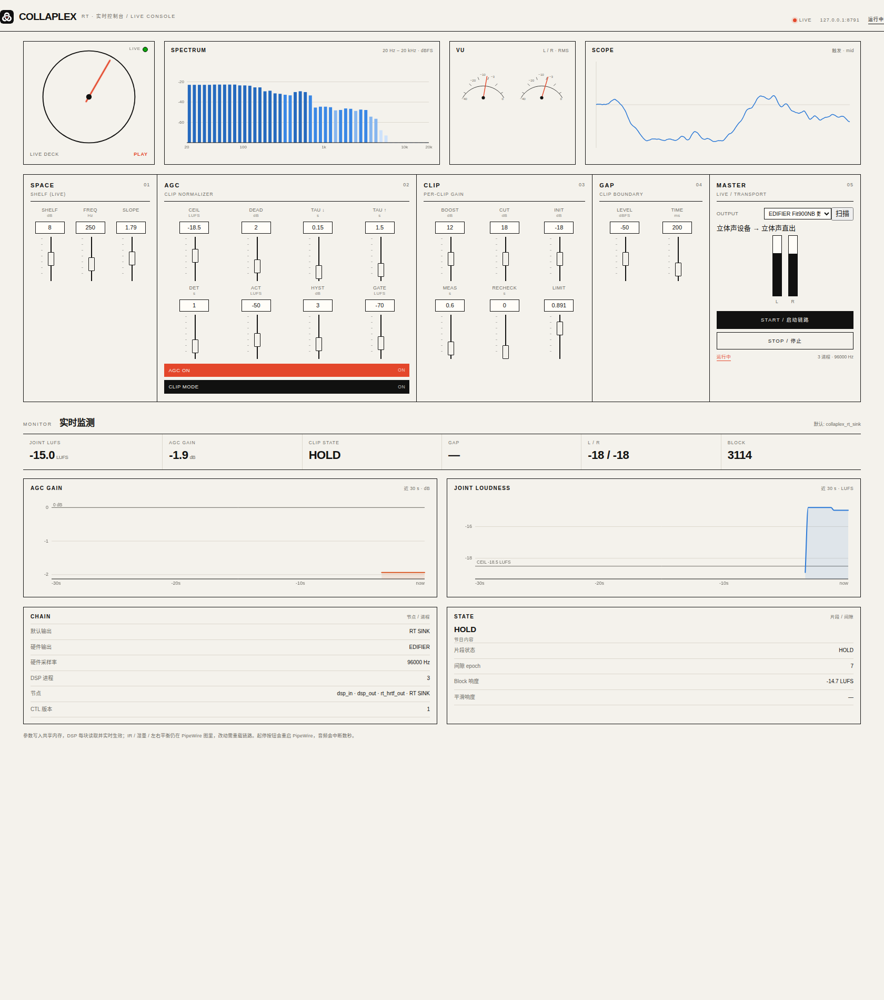

# Collaplex Realtime

实时版 Collaplex：应用 → 虚拟声卡 → HRTF + 影院房间 IR → Rust DSP → 硬件输出。
目标场景是连续切换的短视频/音乐（抖音式），所以电平和 AGC 都在实时链里处理。

## 架构

```
应用
  → collaplex_rt_sink（虚拟声卡，Audio/Sink）
  → HRTF FL/FR + 影院 IR（PipeWire convolver，96 kHz）
  → collaplex_dsp_in（DSP 接入）
  → Rust DSP（每声道一个 pipe 进程）
       低搁架 250 Hz / 8:2（左右平衡在图上）
       → 前馈短时 LUFS AGC（双声道共享能量）
       → lookahead 峰值限幅
  → collaplex_dsp_out → EDIFIER（96 kHz / S24_3LE）
```

- BRIR/混响由 PipeWire 的 convolver 完成（4 条 HRIR + 2 条房间 IR），Rust 只做动态与增益；
- 每声道一个 DSP 进程，靠 `/dev/shm/collaplex-rt-agc` 交换能量，保证双声道同一个 AGC 增益；
- HRTF 前分两路干声（L/R，`collaplex-rt-gap` / `collaplex-rt-gap-r`）：左路检测 200 ms 以上的静音作为换片边界，两路同时做 BS.1770 K 加权响度读取，作为 AGC 的干声锚点（重采样后、任何处理前）；
- 左右平衡放在图里的 `gL/gR` linear 节点，避免 pipe 插件分槽顺序导致左右互换；
- AGC 默认 **按片段（clip）**：检测到干声间隙 → 测新片段开头 0.6 s → 定增益 → 冻结；片段内默认不重测（`CLIP_RECHECK_S=0`），由闭环修正负责残差；
- **快降慢升**：衰减约 0.15 s 完成；提升默认限速 6 dB/s（`AGC_UP_RATE`），10 dB 差约 1.7 s、18 dB 差约 3 s；干声静音时正增益按 1.5 dB/s 放回 0 dB（`AGC_SILENCE_RELEASE`），衰减不受影响；
- **误差比例收敛曲线**：所有增益渐变按“剩余差值”走——差值大时快（有速率上限，约等于原来的平均速率），越接近目标越慢，单调逼近不回冲；比直线和 S 曲线更贴近“梯度下降”的手感；
- 也可切回连续模式：`AGC_MODE=continuous`（3 s 短时 LUFS、快降慢升、激活阈值）；
- 激活阈值 −50 LUFS：低于阈值（−3 dB 迟滞，持续 1 s）退出 AGC，增益约 2 s 放回 0 dB，不上抬安静内容；
- 最后 5 ms lookahead 限幅，ceiling −1 dBFS。

## 干声锚点 + 搁架模型 + 湿声校验

重采样后、任何处理前的两路干声各跑两条测量（gapL / gapR），联合能量按 BS.1770
算 LUFS，发布到 `/dev/shm/collaplex-rt-gap`：

- `dry_block` / `dry_clip`：原始干声的块响度 / 测量窗口响度；
- `shelf_block` / `shelf_clip`：先把同一个低搁架（`SHELF_DB/FREQ/S`）套到干声上，
  再做 K 加权。链路里已知的搁架提升被提前算进去，剩下的才是 HRTF/房间传递。

片段增益分两步：

1. **初值**：换片后 `CLIP_MEASURE_S` 测 `shelf_clip`；房间传递用内容模型预测
   `transfer ≈ −3.2 + 1.30·bass_ratio`（`bass_ratio` 是干声 <250 Hz 能量占比，dB）。
   模型由每次校验的 (低频占比, 真实房间传递) 样本在线最小二乘拟合，先验值给第一次
   换片用；
2. **湿声校验**：影院 IR 1.2 s 尾巴衰减后（`VERIFY_DELAY_S`），用同长度窗口测一次
   搁架/湿声，更新房间传递和内容模型，并按“片段起点的 `shelf_clip` + 真实房间传递”
   重算本段增益，`VERIFY_RAMP_S` 内渐变。

校验只修正**传递估计误差**，不追片段内部的内容起伏。实测：房间传递 Edge ≈ −3.5、
渡口 ≈ −3.9 ~ −5.9 LU；加内容模型后，换片初值误差从 ~5.5 dB 降到 **~0.3–1 dB**，
校验基本只剩 ≤1 dB 的微调。

**闭环修正（非对称硬上限）**：用“增益前联合能量 × 实际增益”算输出短时 LUFS
（能量平均）。**超过 CEIL 用 0.3 s 快窗、每 100 ms 检查，按超出量立即降**
（单次最多 6 dB，0.15 s 渐变，累计最多 24 dB；测量阶段的 0.6 s 也守上限）。
**低于 CEIL−1 dB 并且持续 3 s 才慢慢抬**（单次最多 0.8 dB，3 s 渐变），抬的目标是
CEIL−1 dB，留 1 dB 余量防止再冲上去；累计最多升 3 dB。这样持续段不会超过基准，
代价是动态很大的素材会偏保守 1–3 dB。片段内默认不再重测（`CLIP_RECHECK_S=0`），
10 s 重测会把修正过的增益按原始测量重置，是之前震荡的主因。

安全约束（防止“一下抬老高”）：

- 模型只在低频占比 **−6 … +0.5 dB** 范围内使用，超出范围直接退回近期实测传递，不做外推；
- 提升量受湿声实测约束：`target ≤ CEIL − wet + 1 dB`，不会超过当前信号支持的提升；
  衰减不受此限；
- 低于 **−50 LUFS** 的测量不参与增益决策，避免把停顿/极弱段抬起来；
- 内容模型的拟合只收上述范围内的样本，异常窗口不会把模型带偏。

## 构建与起停

```bash
cargo build --release
./bin/collaplex-rt start    # 安装/重载配置，设备在位时激活链路
./bin/collaplex-rt status
./bin/collaplex-rt stop     # 移除配置，恢复硬件输出
```

`start` 会：
- 探测/复用硬件输出（记录在 `~/.local/state/collaplex-rt/target`）；
- 部署 `~/.local/bin/collaplex-rt-dsp`（wrapper）与 DSP 二进制；
- 渲染 `10-rt-hrtf.conf` / `20-rt-dsp.conf` / `91-rt-clock.conf`；
- 重启 PipeWire，再按设备是否在位进入 **active / waiting**。

### 设备不在位 → 链路待命

目标声卡没接时不会停止软件，也不会把默认输出切到虚拟声卡：

- 配置与 DSP 进程照常保留，控制台照常可用；
- 默认输出留在当前硬件声卡，虚拟声卡不接管系统声音；
- `scripts/target-watch.sh` 常驻监视（`~/.local/state/collaplex-rt/watch.log`）。

设备接上后自动激活：先确认 `collaplex_dsp_out → 目标设备` 已连接（没有就重启一次
PipeWire 让它重新解析 `node.target`），然后按 **模拟 → 数字（目标）→ 虚拟声卡**
的顺序把默认输出切一遍，最后停在 `collaplex_rt_sink`。这样 WirePlumber 会把各设备
恢复成各自的音量，避免开机直接落到虚拟声卡时声音很小。设备拔掉时，默认输出退回
硬件声卡，回到待命，链路配置保留。

## Web 实时控制台

```bash
./bin/collaplex-rt web
# 打开 http://127.0.0.1:8791
```

- 顶部可视化：转盘（播放时旋转）、实时频谱、VU 表（L/R RMS）、触发式示波器；音频取自 DSP 输出环形缓冲；
- 调音台布局：SPACE / AGC / CLIP / GAP / MASTER，参数写入 `/dev/shm/collaplex-rt-ctl`，DSP 每块读取并实时生效；
- 监测：L/R 输入电平、联合 LUFS、**干声锚点 / 湿声片段测量（干/湿）**、**搁架模型与尾巴后校验**、**低频占比 / 房间传递（在线拟合）**、AGC 增益、片段状态（WAIT/MEASURE/HOLD）、干声间隙 epoch、近 120 s 增益/响度曲线；
- START / STOP 调 `bin/collaplex-rt`，会重启 PipeWire，音频中断数秒；
- IR / 湿量 / 左右平衡 / 采样率仍在 PipeWire 图里，改动需重载链路；
- 实时参数写在共享内存里，`start` 会重建 ctl 并回到 wrapper 的环境变量值，不跨重启持久。



## 调参

在 `start` 时用环境变量覆盖，例如：

```bash
AGC_CEIL=-20 AGC_TAU_UP=3 ./bin/collaplex-rt start
BAL_L_DB=3.01 BAL_R_DB=-3.01 ./bin/collaplex-rt start
```

| 变量 | 默认 | 说明 |
|---|---|---|
| `AGC` | `1` | 关闭 AGC 用 `AGC=0` |
| `AGC_CEIL` | `-18.5` | 短时响度上限（LUFS） |
| `AGC_DZ` | `2` | 目标死区（dB） |
| `AGC_TAU_DOWN` / `AGC_TAU_UP` | `0.15 / 1.5` | 快降慢升时间常数（s） |
| `AGC_DET_TAU` | `1.0` | 探测器一阶平滑（s） |
| `AGC_BOOST` / `AGC_CUT` | `12 / 18` | 最大提升/衰减（dB） |
| `AGC_UP_RATE` / `AGC_DOWN_S` | `6.0 / 0.08` | 快降慢升：提升速率（dB/s）/ 衰减渐变（s） |
| `AGC_SILENCE_RELEASE` | `1.5` | 干声静音时正增益放回 0 dB 的速率（dB/s） |
| `TRIM_WINDOW_S` / `TRIM_FAST_S` | `2.0 / 0.3` | 慢窗（抬升判断）/ 快窗（过冲判断） |
| `TRIM_DOWN_MAX` / `TRIM_DOWN_RAMP_S` | `6.0 / 0.08` | 过冲单次下调上限 / 渐变（dB, s） |
| `TRIM_UP_MARGIN` / `TRIM_HOLD_S` | `1.0 / 3.0` | 抬升目标留白（dB）/ 持续多久才抬 |
| `TRIM_UP_KP` / `TRIM_UP_MAX` | `0.3 / 0.8` | 抬升比例 / 单次上限（dB） |
| `TRIM_CUT_MAX` / `TRIM_BOOST_MAX` | `24.0 / 3.0` | 累计向下 / 向上修正上限（dB） |
| `AGC_GATE` | `-70` | 静音门限（LUFS） |
| `AGC_MODE` | `clip` | `clip`（按片段）或 `continuous`（连续） |
| `CLIP_MEASURE_S` | `0.6` | 新片段测量窗口（s） |
| `CLIP_BOUNDARY_MS` | `300` | 后级静音边界（ms，备用） |
| `CLIP_BOUNDARY_LUFS` | `-60` | 后级静音边界电平（LUFS） |
| `CLIP_RECHECK_S` | `0` | 片段内重测间隔；0 = 冻结，由闭环修正负责 |
| `GAP_DBFS` / `GAP_MS` | `-50 / 200` | 干声间隙门限/时长 |
| `VERIFY_DELAY_S` / `VERIFY_RAMP_S` | `1.3 / 2.0` | 尾巴衰减后校验的起点与修正渐变时长（s） |
| `VERIFY_DZ` | `0.5` | 校验死区（dB） |
| `DRY_TRANSFER_INIT` | `-3.0` | 首次房间传递估计（搁架模型干声→湿声，LU） |
| `AGC_ACTIVATE` | `-50` | 连续模式的激活阈值 |
| `AGC_HYST` | `3` | 激活/退出迟滞（dB） |
| `AGC_INIT_DB` | `-18` | 启动/长静音后的保守增益 |
| `SHELF_DB` / `SHELF_FREQ` / `SHELF_S` | `8 / 250 / 1.79` | 响度搁架 |
| `BAL_L_DB` / `BAL_R_DB` | `3.01 / -3.01` | 左右能量 8:2（图上的 gL/gR） |
| `LIMIT_CEIL` | `0.891` | 限幅 ceiling（≈ −1 dBFS） |

## 已验证

- 默认 sink 切到 `collaplex_rt_sink`，硬件 EDIFIER 以 **96 kHz / S24_3LE** 运行；
- 4 个图节点 + 2 个 DSP 进程 + 2 个干声锚点进程正常；
- 1 kHz 正弦（0.5 幅度）实测：AGC 目标/增益一致，输出峰值受控；
- 两段 0.6 s 间隙的 Edge/渡口拼接：间隙检测触发、每段各测一次，增益分别落在 −13.97 / −5.29，段内冻结；
- `pw-top`：HRTF 卷积约 105 µs/块（2048 样本），DSP 约 13 µs/块，CPU 余量很大。

## 注意

- 当前 PipeWire quantum 为 2048（约 21 ms），链路总延迟在几十毫秒级；要更低可调 `default.clock.quantum`。
- AGC 现在是“片段增益 + 干声锚点 + 闭环响度上限”，只做片段电平归一；离线成品仍建议不用 AGC。
- 面板参数写共享内存、实时生效；环境变量（`AGC_*` / `TRIM_*` 等）只在 `start` 时读取。

## 许可

Apache-2.0，允许商业使用；全文见 [LICENSE](LICENSE)，版权与第三方声明见
[NOTICE](NOTICE)，补充说明见 [LICENSING.md](LICENSING.md)。
